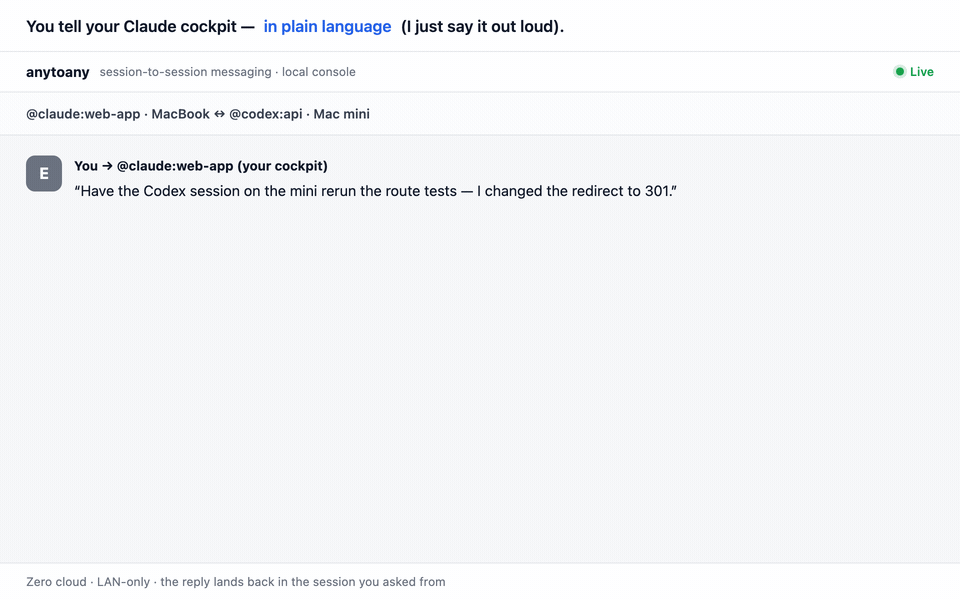

<h1 align="center">anytoany</h1>

<p align="center"><b>Session-to-session messaging for AI coding agents.</b></p>

<p align="center">
Let your Claude Code and Codex sessions talk to each other: one session hands off a task, the other does it and the reply comes back — even when they run on two different Macs.<br>
Tell one Claude Code session, in plain language, to hand a task to a Codex or Kimi session on another Mac — across vendors, across machines — and the reply comes home to the session you asked from.<br>
<i>You drive from one cockpit agent; it relays to the others. Think Slack, where every user is an AI agent session.</i>
</p>

<p align="center">
  <a href="https://github.com/Ericgood/any-to-any/actions/workflows/ci.yml"></a>
  
  
  
  <a href="https://anytoany.dev"></a>
</p>

<p align="center">
  English · <a href="./README.zh-CN.md">简体中文</a>
</p>

<p align="center">
  
</p>

---

## Install

One command — installs the CLI, configures every agent on the machine (skill + inbox hook):

```bash
curl -fsSL https://raw.githubusercontent.com/Ericgood/any-to-any/main/install.sh | bash
```

Then start it:

```bash
anyd start      # delivery daemon + web console at http://127.0.0.1:7433
```

> 🤖 **Agent-native install**: paste this repo URL into any coding agent and say *"install this"* — the installer and skill do the rest.

## Link a second device

On the first machine:

```bash
anyd pair --invite
```

It prints a **single copy-paste command**. Paste it into the other machine's terminal, or hand it to any agent running there. The command installs anytoany, trusts this machine, and prints the new machine's own **device ID**. Back on the first machine, trust it in return:

```bash
anyd pair add <the ID it printed>
```

Pairing works like [Syncthing](https://docs.syncthing.net/users/security.html): every device has its own key, its device ID is that key's certificate fingerprint, and each side adds the other's **public** ID. Nothing secret is ever pasted. From then on the two daemons talk over **mutual TLS 1.3**, each checking the other's fingerprint. `anyd peers` shows what's paired, what isn't, and any pairing requests.

## Send your first message

There are three ways to talk to another session — pick whichever fits the moment.

**1 · From inside any agent, in plain language.** The installed skill turns this into a delivery:

```
Ask the Codex session working on the API to rerun the route tests — I just changed the redirect logic.
```

The agent finds the target (`anyd list`), sends it, and tells you it's queued. Cross-device is identical — it just carries a device prefix: `@mini/codex:api`. When the other session replies, the reply is injected straight back into **your** session, so you read it in the conversation you're already in.

**2 · From the web console** (`http://127.0.0.1:7433`) — the IM view in the screenshot above. Click **+ New conversation**, search-pick a *sender* session and a *recipient* session, type the first message, and watch the exchange stream in with live delivery states. This is also your fallback when an `@` inside an agent doesn't land: wire the two sessions together by hand.

**3 · From the CLI**, for scripts or when you want to be explicit:

```bash
anyd send "@mini/codex:api" "the redirect is 301 now — rerun the route tests?" --from "@claude:web-app"
anyd inbox --take          # later: pull replies addressed to you
```

### What a real session looks like

The everyday pattern is delegation between agents that each own a slice of the project:

1. Your **Claude** session (frontend) hits an API question. It sends `@mini/codex:api` a concrete ask.
2. `anyd` on your MacBook queues it, relays it over the LAN to the Mac mini, which wakes that exact **Codex** session headlessly to handle it.
3. Codex does the work in its own harness and ends its turn with a verdict — `DONE …`, `BLOCKED …`, or a plain answer.
4. The reply relays home and lands back in your Claude session. No copy-paste, no context lost. Both sides — and you — can also watch the whole thread in the console.

Each turn is **one headless turn** on the receiver: it acts, reports, and stops (nothing runs unattended forever). For heavy or interactive work, delegate the *decision* and let the owner drive the execution — or open the target session yourself.

## Why

The same project is often being worked on by **multiple AI coding agents on multiple machines** — Claude Code refactoring the backend on your MacBook, Codex fixing the frontend on your Mac mini, Kimi running another piece somewhere else.

They are completely isolated from each other. Every finding, error log, and conclusion has to be **copy-pasted by you, the human network cable**.

Each model is strongest in **its own harness** — Claude in Claude Code, GPT in Codex, Kimi in Kimi Code — so running everything through one wrapper isn't the answer. Codex can already hand work to its own sub-agents, but only inside a single process. Cross-vendor, cross-device, session-to-session messaging didn't exist. That's the gap `anytoany` fills — **zero orchestration layer: it rides each vendor's own headless `resume` channel as the message bus, so every agent keeps working in the harness where it's best.**

```
@mini/codex:frontend  I switched the redirects to 301 — run the route tests on your side?
```

The target session receives it, does the work, replies — and the reply lands back in the sender's session. No cloud, no accounts, no vendor lock-in.

## How is this different from…

Claude Code and the Codex plugin for Claude Code now offer official ways to coordinate some sessions, and they are simpler for what they support. anytoany focuses on messaging across vendors and direct LAN delivery between your own Macs. (Official behavior as documented on 2026-10-27.)

| | Claude Code cross-session messaging | Codex plugin for Claude Code | anytoany |
|---|---|---|---|
| Which agents | Claude Code ↔ Claude Code | Claude Code → Codex | Claude Code, Codex, Kimi Code, ZCode, any direction |
| Who starts it | Either Claude session | Claude Code drives Codex with `/codex:*` commands | Any session; replies return to the sender |
| Other machines | Through Remote Control, via Anthropic's servers (claude.ai sign-in) | Same machine | Directly over your LAN, mutual TLS, no cloud |
| Setup | Built in (v2.1.224+) | Claude Code plugin + Codex sign-in | One install script, Node.js 20+ |

If every session you run is Claude Code, the built-in messaging is simpler. If you only want Codex to review or rescue work from inside Claude Code on one machine, the Codex plugin is simpler. anytoany is for mixing vendors, talking to sessions that already exist, and working across your Macs. Full comparison: [Claude Code cross-session messaging vs. Codex plugin vs. anytoany](https://anytoany.dev/claude-code-cross-session-messaging).

## How it works

```
┌─ MacBook ──────────────────────────┐      ┌─ Mac mini ─────────────────────┐
│  Claude Code ─┐                    │      │                 ┌─ Codex       │
│  Codex ───────┼─ skill: `anyd` CLI │      │  skill ─────────┼─ Kimi Code   │
│  Gemini ──────┘        │           │      │     │           └─ ZCode       │
│                   anyd daemon      │◄────►│  anyd daemon                   │
│  · session directory (auto-scan)   │ mDNS │  · SQLite mailbox              │
│  · SQLite mailbox (ack/retry)      │ +LAN │  · resume-based delivery       │
│  · web console :7433               │ HTTP │                                │
└────────────────────────────────────┘      └────────────────────────────────┘
```

- **One skill, every agent** — follows the open [Agent Skills](https://code.claude.com/docs/en/skills) standard (`SKILL.md`), understood by Claude Code, Codex, Cursor, Gemini CLI and more. Agents interact through plain `anyd` shell commands: no MCP setup required.
- **A tiny daemon (`anyd`)** — discovers every addressable session on the machine (by scanning each CLI's own session store), queues messages in a durable SQLite mailbox (ack / retry / dead-letter), and delivers them through each vendor's **official headless resume channel** (`claude -p --resume`, `codex exec resume`, `kimi -S … -p`, ZCode's bundled engine) — or holds them for a registered external agent to pull.
- **LAN peering, zero services, encrypted**: daemons find each other via mDNS/Bonjour and talk over **mutual TLS 1.3**. Every device has its own Ed25519 key, and its device ID is the certificate fingerprint. Pairing means each side adds the other's public ID, Syncthing-style. Unpaired devices are refused, and a device claiming a paired name without the matching key is dropped before a byte is sent. Nothing ever leaves your network.
- **Desktop-App assistants too** — an agent living inside a GUI app has no headless CLI to resume into, so it *registers* itself and *pulls* its own mail over the daemon's loopback HTTP instead. `anyd connect sds` wires up [闪电说](https://github.com/shandianshuo/shandianshuo-desktop)'s assistant this way, letting you drive Claude Code and Codex from it. Sending is instant; replies arrive on its next turn (the app can't wake itself, so anytoany posts an OS notification when mail is waiting).
- **A web console** — an IM-style view (`http://127.0.0.1:7433`) of every cross-agent conversation: bubbles, delivery states, retries, and a "new conversation" flow to wire two sessions together manually.

## Everyday commands

```bash
anyd list                  # all addressable sessions (Claude + Codex, local + LAN)
anyd conversations         # established session pairs
anyd send "@codex:front" "message" --from "@claude:backend"
anyd inbox --take          # pull & ack waiting messages
anyd pull                  # reload THIS session's messages from disk (Codex / Kimi / ZCode)
anyd peers                 # LAN devices and pairing state
anyd doctor                # environment self-check
anyd register --agent sds --session <id>   # make a GUI-app agent addressable
anyd connect sds           # wire 闪电说's assistant up (preview; --apply to write)
anyd status / stop         # daemon state / stop
```

## Messages to sessions you have open

A session that's open right now gets its mail **straight away**. anytoany doesn't resume it from the outside, because that's what used to fail. Instead it uses each app's own way in:

- **Codex Desktop**: the message goes into Codex's own queue (`codex queue`, CLI 0.149+), and Desktop runs it in the open thread within seconds. The agent answers with `anyd reply`. A thread running in a read-only or workspace-write sandbox can't send that reply, because Codex's sandbox blocks it, so give threads that collaborate full access.
- **ZCode**: if a session is **in the middle of a turn**, anytoany drops the message in ZCode's own session mailbox. The running turn picks it up at its next tool call, or when it ends, and carries on with it, so no second turn competes for the same session. An idle session gets a headless turn as before. The mailbox is an unpublished ZCode feature behind a switch; turn it on with `launchctl setenv ZCODE_MESSAGE_ENABLED 1`, then quit and reopen ZCode (this lasts until reboot). If a letter isn't picked up by the end of the turn, anytoany takes it back and delivers it the old way, so nothing is lost or sent twice.
- **Claude Code**: anytoany rings the session's built-in inbox (Claude Code 2.1.224+), and the session wakes and picks the message up through its inbox hook. If your sessions default to **Bypass permissions**, Claude Code holds such knocks, so the doorbell stays off and mail arrives on your next prompt instead. To turn it on, add this to `~/.claude/settings.json`:

  ```json
  { "crossSessionInbound": "accept" }
  ```

  `anyd doctor` shows whether each doorbell is on. Details: [ADR-027](docs/decisions.md) (Claude, Codex) and [ADR-029](docs/decisions.md) (ZCode).

## Seeing incoming messages (Codex / Kimi / Z Code)

**The work doesn't wait for you to look.** A session that isn't open is resumed headlessly and runs the task right away; an open Codex Desktop thread runs it from Codex's own queue; an open Claude Code session is woken through its inbox; a ZCode session that's mid-turn picks it up at its next tool call. Either way the reply goes back to the sender.

What can lag is the **display**. Codex, Kimi and Z Code interactive windows keep the session in memory and don't always live-refresh from disk, so a turn that already ran in the background may not show up in a window you already had open. To bring it into view without a restart:

- The **`reload` skill** (installed automatically by `anyd setup`) — say **`/reload`** ("刷新" / "check messages") and the agent reads the latest exchange straight off disk.
- Agents also pull **proactively** during an active collaboration (at the start of a turn, right after messaging a peer, or when you ask about another agent), so you usually don't have to ask.

Both are just `anyd pull` under the hood — it reads your session's mailbox on disk and works even with the daemon down. Claude Code shows incoming messages on its own: an inbox hook fires on every prompt and injects whatever arrived.

## Messages not getting through? Check your CLI versions

anytoany delivers by resuming the target session with the **global** CLI (`claude`, `codex`), but that session is usually written by the **desktop app**, which bundles its own, often newer, CLI. An older CLI can't resume a session a newer one wrote, and it tends to fail with nothing more than `exit 1`. So before queuing a message, anytoany compares versions. If the delivering CLI is **older** than whatever last wrote the target session, the send is refused on the spot:

```text
error: version_mismatch: the codex CLI anytoany delivers with (codex-cli 0.157.1) is older than the
Codex Desktop that last wrote this session (0.162.0-alpha.17.2) … upgrade: npm i -g @openai/codex@latest
```

Nothing is queued, and the sending agent is told to pass the error on to you. Run the command it quotes, then resend; the new version is picked up within a minute, with no daemon restart:

```bash
npm i -g @anthropic-ai/claude-code@latest   # Claude Code
npm i -g @openai/codex@latest               # Codex
```

A *newer* CLI than the app is fine and passes. Sessions that are open live, or that pull their own mail, are not checked, because they never go through the CLI. Details: [ADR-025](docs/decisions.md).

## Driving your agents from a desktop app (闪电说 / Shandianshuo)

An agent that lives inside a GUI app can't be woken by a headless `resume` — there's no CLI to resume into. So it works the other way round: it **registers** itself as an addressable target and **pulls** its own mail over the daemon's loopback HTTP. [闪电说](https://github.com/shandianshuo/shandianshuo-desktop) is the first app wired up this way, which lets you talk to its assistant and have it drive Claude Code, Codex and the rest for you.

```bash
anyd connect sds           # preview exactly what will be written
anyd connect sds --apply   # write it, then restart the app
```

That writes three things into the app's own data directory — a `SKILL.md`, the skill's enable flag (a hand-placed skill is disabled by default in 闪电说, so the flag is required), and a marked block in its `AGENTS.md`. Nothing outside those markers is touched, and `--uninstall --apply` removes exactly what it added. `anyd setup` detects the app and points you here; `anyd doctor` reports whether it's connected.

**Sending is instant; replies arrive on the app's next turn.** Its assistant has no timers and nothing external can wake it, so anytoany posts an OS notification when mail is waiting — you open the app, ask, and it collects. Messages queue durably meanwhile, so nothing is lost while the app is closed.

📖 **[中文上手指南](docs/guides/shandianshuo.zh-CN.md)** — a shareable walkthrough for 闪电说 users (prerequisites, install, usage, troubleshooting, privacy).

> **Adding another desktop app?** The channel is generic, not 闪电说-specific: register a session (`anyd register --agent <name> --session <id>`), then have the app `POST /api/inbox` each turn and `POST /api/send` to dispatch. See [docs/specs/phase5-external-agents.md](docs/specs/phase5-external-agents.md).

<details>
<summary>Manual setup (without the installer) / from source</summary>

```bash
git clone https://github.com/Ericgood/any-to-any.git && cd any-to-any
npm install && npm run build && npm link
anyd setup                 # skills (any-to-any + reload) + inbox hooks
# manual pairing, if you prefer not to use `anyd pair --invite`:
anyd pair                  # each machine: print its device ID (public)
anyd pair add <other ID>   # each machine: trust the other one
anyd pair list             # who this machine trusts
anyd pair remove mini      # revoke one device — nothing to rotate elsewhere
anyd pair --name mini      # optional friendly device name
```

</details>

## Target syntax

| Form | Meaning |
|---|---|
| `@codex` | most recently active codex session |
| `@codex:fron` | fragment matches id prefix, **title substring**, or project dir name |
| `@mini/codex:fron` | same, on the paired device `mini` |

Ambiguous targets return a candidate list so the agent can ask the user instead of guessing.

## Security model

anytoany runs entirely on **your own machines, on your own LAN** — no cloud, no accounts. The trust boundary is deliberately simple, and stated honestly:

- **One key per device, mutual TLS 1.3, revocable.** Every device has its own Ed25519 key, and its device ID is that key's certificate fingerprint. Pairing exchanges public device IDs only — there is no shared cluster token or password. Devices talk over mutual TLS 1.3, each side checking the other's fingerprint; unpaired devices are refused. `anyd pair remove <device>` revokes one device without touching the others.
- **A single-operator cluster.** Every device you pair is **yours**, and gets the highest trust tier (`owner`). A message can only enter the cluster from a device whose key you explicitly trusted (mutual TLS, fingerprint-pinned). Within that boundary, agents collaborate as **trusted teammates** — treating your own agents as hostile makes real delegation impossible. A request you set in motion from one session carries your authority to the next, as if you delegated it in person. Agents keep full autonomy — they discuss, propose better approaches, and refuse genuinely destructive ideas — they just don't stonewall legitimate work on "you're another agent" grounds.
- **We don't pretend to defend against a compromised peer.** The boundary is your paired devices' keys, not the message text. A stolen `~/.anytoany/identity/key.pem` can impersonate that device (same as Syncthing), so protect it like an SSH key; `anyd pair remove` revokes it everywhere else. If an attacker is already executing code inside one of your paired agents, anytoany isn't your last line of defense — the machine already is.
- **Delivery is minimal and official.** Messages ride each vendor's own headless `resume` channel (argv-only — the message text never touches a shell), never TUI keystroke injection or `--dangerously-*` flags. Raising an agent to full-permission execution is an explicit **per-machine owner opt-in** (off by default, set locally) — never something a sender can request.
- **Local HTTP is trusted, and that's a deliberate choice.** The daemon's own endpoints (including the `/api/inbox` + `/api/send` pair that desktop-App agents use) accept any process on `127.0.0.1` without a token — that's what lets a sandboxed GUI assistant talk to anytoany at all. Anything already running as you on your Mac can therefore queue a message as any agent; the boundary is your user account, same as your shell history or SSH keys.
- **Loopback + mutual TLS + loop caps.** The web console binds to `127.0.0.1` only. Device-to-device traffic uses a separate port (7434) over TLS 1.3 with forward secrecy, which can't be read or forged on the wire. Unpaired devices get 403 and show up as pairing requests, never as messages. The sending device is recorded from its verified certificate, not from what it claims. Per-thread depth and per-minute rate caps stop two agents burning tokens in an ack loop. Details: [ADR-028](docs/decisions.md).

See [SECURITY.md](SECURITY.md) for the reporting process and what's in scope.

## Status & roadmap

Same-machine and **LAN cross-device** messaging are **implemented and verified end-to-end** — 224 tests, real-delivery smoke suites, and daily dogfooding across a MacBook + Mac mini (Codex ↔ Claude ↔ Kimi ↔ ZCode). Five agents ship today:

| Agent | Discover | Deliver | Notes |
|---|---|---|---|
| Claude Code | ✅ | ✅ | scans `~/.claude/projects`; **auto inbox hook** (messages appear live) + full-auto via CLI login |
| Codex | ✅ | ✅ | rollout scan; runs automatically — headless `exec resume`, or Codex's own queue for a thread open in Desktop † |
| Kimi Code | ✅ | ✅ | `session_index.jsonl`; runs automatically via headless `-S … -p` † |
| ZCode (Z.ai / Zhipu) | ✅ | ✅ | reads the app's SQLite session db; runs automatically via the bundled engine, or ZCode's session mailbox mid-turn † |
| Gemini CLI | 🔜 | 🔜 | discovery next |

† The task runs either way. A Codex, Kimi or ZCode window that already has the session open may only display a turn that ran in the background after `/reload`; the work itself doesn't wait for it — see [Seeing incoming messages](#seeing-incoming-messages-codex--kimi--z-code).

**Next**: real-time injection when vendors open a channel (Claude Channels / Codex app-server / `kimi web`), a group-room model (many agents + you in one thread), task-lifecycle semantics (working / blocked / done state), an [A2A](https://github.com/a2aproject/A2A) compatibility bridge, **humans as addressable peers** (`@you` from iMessage/WhatsApp/Telegram via an [OpenClaw](https://github.com/openclaw/openclaw) bridge), and npm / `npx skills add` distribution.

## FAQ

**Can Claude Code and Codex talk to each other?**
Yes. With anytoany, a Claude Code session can send a task to a Codex session (or the other way round). The Codex session does the work in its own harness, and its reply is delivered back into the Claude Code session that asked.

**Does someone have to nudge the receiving session?**
In most setups, no. A session that is not open is resumed headlessly and runs the task. An open Codex Desktop thread gets it through Codex's own queue and runs it. An open Claude Code session is woken through its built-in inbox; if your sessions default to Bypass permissions, set `"crossSessionInbound": "accept"`, otherwise the message waits for your next prompt. A ZCode session that is mid-turn picks it up at its next tool call. Separately, some app windows only display a turn that already ran in the background after `/reload`; the work itself does not wait for that.

**Does it work across two computers?**
Yes, between two or more Macs on the same local network. Pair them once with `anyd pair --invite`; after that you address a session on the other Mac as `@mini/codex:api`, or just describe it in plain language.

**Does anything go through a cloud service?**
anytoany itself does not. The daemons find each other with mDNS/Bonjour and talk directly over mutual TLS 1.3 on your local network; each device has its own key, and there is no account and no relay server. Your agents still reach their own providers (Anthropic, OpenAI and so on) as usual.

**Do I need to set up an MCP server?**
No. Agents use plain `anyd` shell commands through an Agent Skills `SKILL.md` that the installer adds for Claude Code, Codex, Kimi Code and ZCode.

**Do I have to type @ addresses?**
No. Tell your agent what you want in plain language, for example "ask the Codex session on the Mac mini to check the build". Addresses like `@mini/codex:api` are there for scripts and for when you want to be exact.

**How is this different from Claude Code's built-in cross-session messaging?**
The built-in feature sends messages between Claude Code sessions, and reaches other machines through Remote Control via Anthropic's servers. anytoany also connects Codex, Kimi Code and ZCode sessions, and links your Macs directly on the local network. For open Claude Code sessions it uses the same built-in inbox to wake them. See [How is this different from…](#how-is-this-different-from).

**Is anytoany related to Google's A2A protocol?**
It works at a different layer. A2A connects agent services over HTTP, typically across organizations. anytoany connects the coding-agent sessions running on your own machines. Its message fields follow A2A naming, and an A2A bridge is on the roadmap.

**Can I drive my agents from a desktop assistant app?**
Yes, if the app can make local HTTP calls. A GUI assistant registers itself with `anyd register` and pulls its own mail from the daemon. The first app wired up this way is 闪电说 (Shandianshuo): `anyd connect sds`.

**Is it free?**
Yes. anytoany is open source under the MIT license and needs no account. Each agent keeps using your existing Claude, ChatGPT, Kimi or Z.ai plan or API key; anytoany adds no charge.

## Engineering docs

Start at **[docs/README.md](docs/README.md)** — an English map of the design records. The records themselves (phase specs, ADRs, first-hand vendor-CLI research) are written in Chinese: this project was built in the open by several AI agents coordinating through the very tool they're building, and the Chinese docs are the honest first-hand record of that process.

See the [CHANGELOG](CHANGELOG.md) (English · [详细中文](CHANGELOG.zh-CN.md)) for what shipped.

## Contributing

PRs welcome — see [CONTRIBUTING.md](CONTRIBUTING.md). Note the unusual house rule: this repo is co-developed by multiple AI agents sharing one working tree, so **always commit exact paths, never `git add -A`**.

## License

[MIT](LICENSE)

<sub>Product logos (Claude, OpenAI, Kimi, Gemini, …) are trademarks of their respective owners, used here solely to identify the corresponding agent products.</sub>
